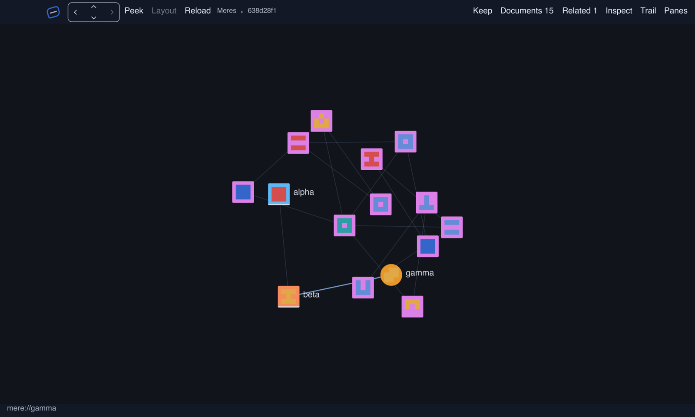
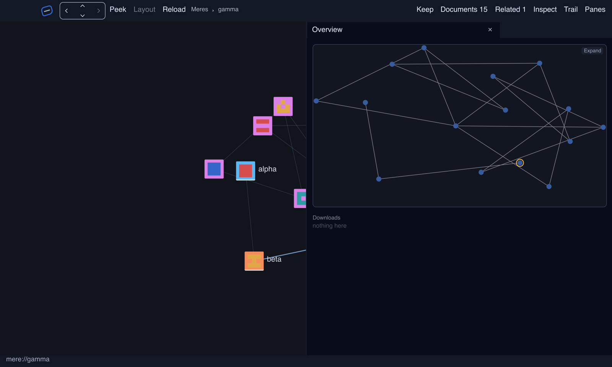
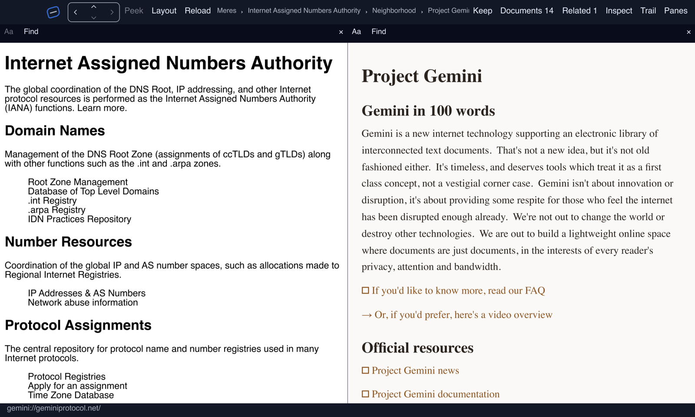

# turnstone

Turnstone is a local-first browser for shared, addressable places where people
talk, author, publish, and bring other webs into view. Its canvas relates
people, conversations, shared places, documents, services, and remote
resources in one durable graph. HTTP and the smolweb protocols are resource
and exchange lanes within that peer web rather than the product's boundary.

Turnstone is built on
[mere](https://github.com/merely-made/mere), the graph datalake library and
repository home of the peer-domain packages it composes. Mere supplies graph
truth and portable projections; Murm supplies invited exchange; Gemot governs
durable moots; the Commons profile supplies shared graph and channel
convergence; Knot owns authored documents; and Genet presents local and remote
content.

<p align="center">
  <br>
  <sub>Three sample meres on the graph canvas. Each tile is a document; the chrome carries navigation, Keep, and the pane menus.</sub>
</p>

Be disclaimed: I use AI to develop this entire stack, as a tool, carefully, and with review.

Read projections use the shared Cambium toolbar for text size, column width,
and Find. Text and measure choices persist per pane and reading access;
search text, match position and display density are temporary. Native chrome
resolves logical sizes for each window's display, independently of the reading
surface and the saved UI zoom.

## Build and run

Windows native builds need the MSVC C++ build tools, Windows SDK, CMake and
Ninja. The CEF dependency downloads its matching binary distribution when needed;
set `CEF_PATH` to an existing matching distribution to reuse it. This is a native
SDK input, separate from Cargo's source redirects.

```sh
cargo run     # the turnstone window
cargo test    # unit tests
```

`TURNSTONE_CLICK_SLOP_PX` sets how far a contributed-pane mouse press may
move before it becomes a drag. The value is a finite, nonnegative number of
physical window pixels, default `4`; invalid values use the default. Set it
before starting Turnstone. A release must still hit the pressed target, and
Cancel always prevents a click.

Turnstone pulls `mere` and the genet engine family as git dependencies; a plain
`cargo build` fetches them. Headed self-drive receipts live under `scenarios/`.
The committed `Cargo.lock` records the portable graph on Rust 1.99.1. Run
`cargo check --workspace --locked`, or use Python 3.11+ to check configuration,
package provenance and lock preservation with `python scripts/cargo_mode.py verify`.

For sibling development, copy `.cargo/config.toml.example` to
`.cargo/config.local.toml` and adjust the paths. Existing users run
`python scripts/cargo_mode.py setup` once: current locks are preserved and ignored
automatic configs become opt-in local configs. Run
`python scripts/cargo_mode.py local check --workspace` for sibling resolution;
it requires Cargo 1.97+ and uses `.cargo/local/Cargo.lock`. Bare Cargo and editor
metadata use the portable graph; configure editor checks to use the launcher
when working across repositories. Local config and locks are never committed.

Mere, Genet, Knot and the other family repositories are followed on their
`main` branches; `Cargo.lock` records the exact revisions a build used.
Independently developed suppliers (Armillary, Eidetic, Gemot) stay on fixed
revisions. Advance the lock as a tested set rather than on every sibling commit.
A local build and a redirect-free locked build are separate checks.

NomadNet pages over Reticulum are optional: `cargo run --features nomadnet`
links Retinue, whose terms bar uses contributing to model training, so no default
build carries it. Without the feature a `destinationhex:/path` address still
parses and the Micron projection still renders saved source, and a page request
answers with a typed refusal. `scripts/check_default_links.py` keeps the default
free of Reticulum engines.

The local Windows system-webview implementation is optional:
`cargo run --features scry`. It requires the WebView2 runtime and a D3D12 host;
construction failures are reported by the browser. Two-page native qualification
records cookie retention and current captured pixels in the
[supplier integration receipt](docs/receipts/browser_supplier_integration_20261006/README.md).

Knot and Redshank share the Mere/Genet surface family with Turnstone, so
retained-surface, publishing and projection interfaces have one source identity.
The [current-family receipt](docs/receipts/browser_family_20261007/README.md)
records the Servo 0.7 and CEF `154.5.0+154.0.34` browser suppliers.

## Status

Working reference host. Turnstone obviated mere's former `meerkat` crate on
2026-07-18: the behavioral deletion matrix went green and meerkat left mere's
tree, so the browser host now lives here as its own binary over the `mere`
library.

What runs today: the graph canvas (pan / zoom / isometric, deterministic
layout strategies); a summonable omnibar (find / go / actions lanes);
back, forward, reload; clean-room `genet.livery`, Reader and native smolweb
document lanes, plus optional Windows `weld.chromium`, with a per-node viewer
override; retargeting panes (Roster, Trail, Gloss and Inspector) and a
platen-tiled Workbench; multi-window lenses with identity-preserving pane and
tile tear-out; and multi-session (`sessions/<id>/` with a switcher and
restart restore). Dated scenario receipts record their exact native behavior
and accessibility scope; broader human accessibility acceptance remains open.

The live place port composes Personae, Gemot and shared graph/chat convergence.
Recorded native place scenarios cover shared addresses, reader write refusal,
reconnect and a founder-held Knot document edited through its projection.
That document path depends on its holder being online. The exact scope is in
the [place port plan](design_docs/2026-07-28_turnstone_place_port_plan.md).

Current browser work follows the
[user-agent taxonomy](design_docs/2026-08-03_user_agent_taxonomy_plan.md):
registry-derived engine choices and optional Windows Scry, Weld and
Servo/Graft hosts on the existing wgpu device. Scry and Weld use per-node
profiles; Servo shares one explicitly named, configurable process profile
across its views. The [integration receipt](docs/receipts/browser_supplier_integration_20261006/README.md)
records scoped Scry/Weld input, persistence, permission and teardown controls,
and mixed-runtime pixels. Servo's default reopen can still produce a white
frame. Those captures qualify their recorded binaries; the upstream repin
requires fresh native checks. Current-family resize probes also expose stale
Servo pixels after the page has received its new viewport. Explicit GPU
completion diagnostics have positive and negative controls; reliable default
ordering remains a Graft release gate. Foreign accessibility, OS IME, lenses and
native rehosting remain separate gates.

The portable source includes two published Mozilla private ICU packages with
three dependency ranges widened; their Rust, data and license bytes are
preserved. An exact official ICU CAPI release source isolates its FFI-facing
2.1 family from Genet's newer Rust ICU family. Provenance, resolver controls
and seven page-native Intl/normalization probes are in the current receipt.

The local October engine-picker patch derives choices from actual registries,
uses human labels, and keeps unavailable saved pins visible with reasons. Its
[qualification receipt](docs/receipts/browser_engine_inventory_20261005/README.md)
records default/optional-Weld tests and the native picker scenario.

The live plan is `design_docs/2026-07-10_turnstone_architecture_plan.md`; the
founding brief is `design_docs/2026-07-08_turnstone_founding.md`.

## Screenshots

<p align="center">
  <br>
  <sub>The Overview pane keeps the graph's whole shape in view while the canvas stays on the focused node.</sub>
</p>

<p align="center">
  <br>
  <sub>The Workbench tiles graph nodes into live document surfaces beside the canvas (captured 2026-10-06 on Windows, before the current chrome).</sub>
</p>

The canvas and Overview images come from `scenarios/readme_screenshots.scn`;
run it with `TURNSTONE_SCENARIO` set to that file and a fresh `TURNSTONE_ROOT`.

## Retained answers

`Ask retained text` opens an answer pane for the current browsing session.
It connects to Djinn's `inference.ask` route using `GRAPHSHELL_APP_ENDPOINT`
(or the configured default endpoint). Djinn must have an inference model
selected in its owner settings. The pane shows streamed text, token progress,
pause/resume/cancel, and past asks. Source buttons open the exact retained
version with its hash and character range. An exact-quotation annotation means
the supplied passage appears verbatim; a source marker records the model's
reference to supplied material.

The trail actor lends retained text to the resident while the pane is open.
Only passages supplied to an ask enter its sealed run journal. This first
handoff refuses publication JSON above 128 KiB; use a smaller browsing session
when that limit is reached. The [native I5 receipt](docs/receipts/resident_inference_i5_windows_20261016/native/execution.json)
qualifies the pinned GPU model, pause/resume, cancellation, and restart with
the fixture origin offline. It uses a test-owned native Djinn resident.

## Graphshell endpoint

Turnstone exposes its first local Graphshell projection through the library's
`remote_projection` adapter. Mere cartography maps the live graph into a
sceno spiral and routed relations; Graphshell resolves separately
transferred cards and returns advertised intents through Servitor. The G3
receipt and exact acceptance boundary are recorded in
`docs/2026-07-22_g3_graphshell_endpoint_receipt.md`.

## License

MPL-2.0 (see LICENSE).
