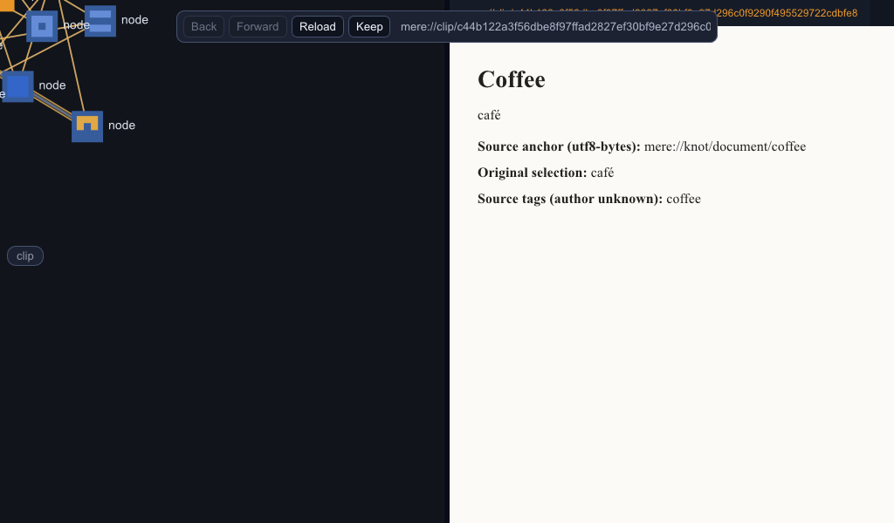
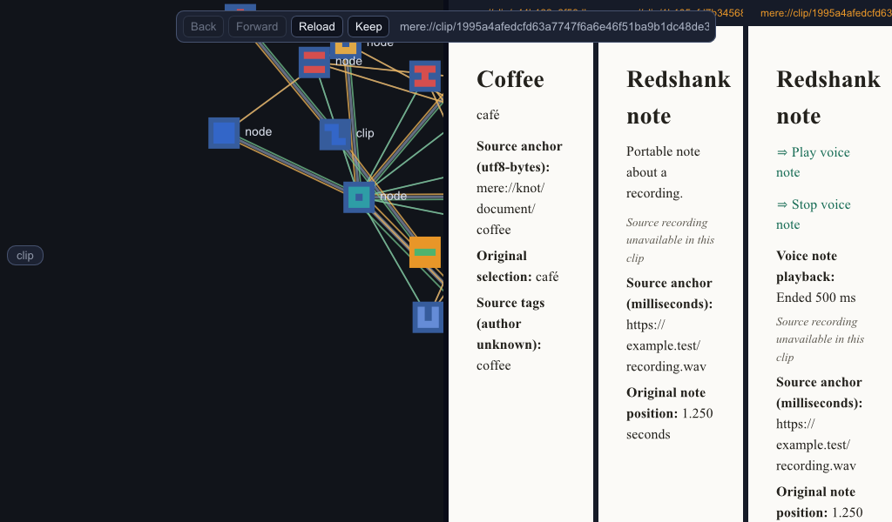

# Retained clip receiver qualification

**Status (2026-10-11):** qualified for the bounded Windows default-feature
receiver. Source commit `d2fb07c1ccb70edb3943986432905aa7f5247e46` imports selected
plain-text and WAV bodies, reads them in the real host, and replays retained
audio after a fresh-process restart with the package paths unavailable.

The receiving behavior and remaining gates are in
[the host plan](../../../design_docs/2026-10-11_retained_clip_receiver_plan.md).
The draft shared contract belongs to the Eidetic development plan in Mere.

**Follow-up (2026-10-12):** [selected onward export](onward/README.md) qualifies
export from this receiver into a second independent native mere, preserving
source facts and selected-content identities through a package-unavailable
restart. It records 794 library passes, ten final focused controls and nine
reviewed onward captures. The original qualification below remains dated.

## Evidence

| Gate | Result |
|---|---|
| Broad library regression before the final focus/read hardening | 789 passed, 0 failed, 10 existing ignores |
| Final receiver regression | 6 passed, including disk reopen, real Inker session, altered/missing/unsupported/over-budget input, host-only controls and Workbench focus |
| Final offline blocking-port regression | 1 passed |
| Locked, offline default binary and package-producer build | Passed |
| Committed-source native import | `seed-final/scenario.done`: passed; 4 captures |
| Fresh receiver, packages unavailable, visible Play link clicked | `reopen/scenario.done`: passed; 4 captures |
| Missing local retained identity | `missing/scenario.done`: passed; 1 capture, failed content state without acquisition |
| Resolved Mere contracts | One immutable Git source, 75 packages; one each of Eidetic, Muniment, Fleece, Inker, Cambium, endpoint and fetch |

All nine accepted captures were reviewed. The Knot view reads `café` and shows
its original byte selector and source tags with unknown attribution. The text
note shows its authored body and original 1.250-second recording position.
Voice playback reaches **Ended 500 ms** while the view separately says
**Source recording unavailable in this clip**. The reopened Play link was
activated through normal physical pointer routing into the document session.





Every accepted scenario asserts zero acquisition attempts and zero eager peer
services. While the three processes were running, 62 socket samples found
zero TCP connections and UDP endpoints owned by them. These are sampled endpoint
observations, not a packet trace. The app's offline fetch ports refuse requests;
the peer reader/publisher is not started. Custody IPC uses the synthetic Djinn
fixture. No system network settings or user vault were changed.

The package producer had exited before import. The receiving process exited
between stages. Before reopening, all three original package paths were made
unavailable; `reopen/package-availability.json` records that state. The new
process resolves content from its own durable store and plays only the retained
WAV body. It has no recording bytes and never requests the original URL.

[qualification.json](qualification.json) binds the source commit, binaries,
lockfile, tests and native outcomes. [dependency-identity.json](dependency-identity.json)
records the single-source graph. [artifact-sha256.json](artifact-sha256.json)
binds copied logs, packages, diagnostics and captures. The generated packages
are authored synthetic fixtures, available under `packages/` for inspection.

The initial precommit scenario failed two focused-content assertions: import
could toggle the previous Workbench member. `initial-failure/` preserves that
failure and its captures. `development-repaired/` and `development-clean/`
preserve intermediate runs. They are development evidence, outside the accepted
committed-source qualification above. The final code opens its exact retained
reference and has a regression for that trigger.

## Reproduce

Use the source commit above and its lockfile, with no machine-local Cargo
redirects. The runtime below must be new. The published Mere custody receipt
host is built with `cargo build -p djinn --bin dr-c-receipt-host --features
custody-receipt-host --target-dir C:/t/cargo-targets/mere` from Mere. It creates
only a synthetic fixture vault under the named new directory.

```powershell
cargo test --lib retained_clip --locked --offline --target-dir C:/t/cargo-targets/turnstone
cargo test --lib offline::tests --locked --offline --target-dir C:/t/cargo-targets/turnstone
cargo build --bin turnstone --example retained_clip_packages --locked --offline --target-dir C:/t/cargo-targets/turnstone
$clipRuntime='C:/t/cargo-targets/turnstone/retained-clip-runtime'
New-Item -ItemType Directory -Path $clipRuntime
Set-Content "$clipRuntime/.retained-clip-generated" 'owned receiver qualification'
& C:/t/cargo-targets/turnstone/debug/examples/retained_clip_packages.exe "$clipRuntime/packages"
$clipAddresses=Get-Content -Raw "$clipRuntime/packages/addresses.json" | ConvertFrom-Json
$clipEndpoint='\\.\pipe\turnstone-retained-clip-receipt'
$clipBroker=Start-Process C:/t/cargo-targets/mere/debug/dr-c-receipt-host.exe -ArgumentList $clipEndpoint,"$clipRuntime/broker",unlocked -WindowStyle Hidden -PassThru
# Wait for broker/ready before launching the receiver.
$env:GRAPHSHELL_APP_ENDPOINT=$clipEndpoint
$env:TURNSTONE_ROOT="$clipRuntime/receiver"
$env:MERE_ROOT="$clipRuntime/shared"
$env:TURNSTONE_OFFLINE='1'
$env:CLIP_PACKAGE_KNOT="$clipRuntime/packages/knot.mereclip"
$env:CLIP_PACKAGE_NOTE="$clipRuntime/packages/note.mereclip"
$env:CLIP_PACKAGE_VOICE="$clipRuntime/packages/voice.mereclip"
$env:CLIP_KNOT=$clipAddresses.knot
$env:CLIP_NOTE=$clipAddresses.note
$env:CLIP_VOICE=$clipAddresses.voice
$env:TURNSTONE_SCENARIO="$PWD/scenarios/retained_clip_seed.scn"
$env:TURNSTONE_CAPTURE_DIR="$clipRuntime/seed-final"
Start-Process C:/t/cargo-targets/turnstone/debug/turnstone.exe -WindowStyle Hidden -Wait
# Require seed-final/scenario.done to begin RESULT ok.
Move-Item -LiteralPath "$clipRuntime/packages" -Destination "$clipRuntime/packages-held-away"
$env:TURNSTONE_SCENARIO="$PWD/scenarios/retained_clip_reopen.scn"
$env:TURNSTONE_CAPTURE_DIR="$clipRuntime/reopen"
Start-Process C:/t/cargo-targets/turnstone/debug/turnstone.exe -WindowStyle Hidden -Wait
$env:TURNSTONE_SCENARIO="$PWD/scenarios/retained_clip_missing.scn"
$env:TURNSTONE_CAPTURE_DIR="$clipRuntime/missing"
Start-Process C:/t/cargo-targets/turnstone/debug/turnstone.exe -WindowStyle Hidden -Wait
```

Require both later `scenario.done` files to begin `RESULT ok`, then inspect the
captures. Stop only the owned fixture broker after matching its PID and command
line. Archive the evidence before removing its marker-owned runtime. This run
reused the stable Turnstone target; no worktree or isolated Cargo home was made.

## Limits

This is selected plain-text and WAV receiving/playback, with an authored
500 ms PCM tone. It does not qualify acoustic quality, live voice capture,
the original recording, standalone producer GUI workflows, Linux/macOS, browser
guests or browser-hosted meres. The narrow four-cell missing-content capture
shows failure but clips the full error caption; diagnostics retain the reason.
`TURNSTONE_OFFLINE` is scoped to the exercised acquisition ports and eager peer
services; this receipt does not qualify every place command or optional browser
guest as an offline policy.

The retained store is explicitly unsealed in this slice. Identity/destination
admission and hash checks pass, while encrypted custody and retention/deletion
policy remain P6 work. Additional assets and structured formats, source-backed
excerpts, signed tags and accepted suggestions, reviewed reconnect edits and
peer delivery keep their separate shared-plan gates.
