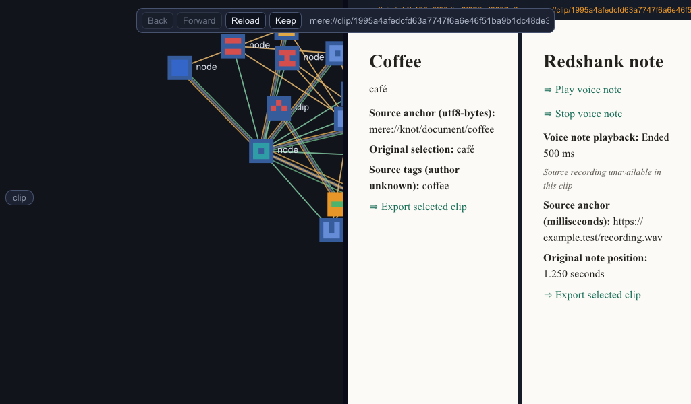

# Selected onward export between two native meres

**Status (2026-10-12):** qualified for the bounded Windows default-feature path.
Implementation source is `97c139442cdc0600f1a5629eec1a40cb27f2a917`; the qualification
follow-up corrects the scenario's physical Play coordinates and adds damaged/
missing-held-body refusal controls. Runtime source stays unchanged.

The first mere receives all three authored packages from the original
[receiver fixture](../README.md). After the original paths become unavailable,
its host exports only the selected Knot and WAV voice-body clips. The two
onward envelopes equal the original selected packages exactly after JSON
decoding. No text-note package is exported. The sending app exits before the
second independent mere starts. Both stores use the same synthetic persona,
on one Windows machine; this is not peer delivery or a two-device receipt.

The second mere imports the chosen packages, reads `café` with its byte-source
anchor and unknown source-tag attribution, and plays its retained WAV body to
Ended 500 ms. All package paths then become unavailable. A new second-host
process reopens the same references and replays through the visible Play link.
Original recording bytes remain unavailable, with the original 1.250-second
note position preserved. Requesting the unselected note's address fails locally
without fetching its original source. That requested visit is a reference;
the unselected retained record and bytes were not admitted.

## Gates

| Check | Outcome |
|---|---|
| Final runtime library regression | 794 passed, 0 failed, 10 existing ignores |
| Focused receiver/export controls | 10 passed; subsequent held-body corruption/deletion control also passes |
| Default binary and fixture-producer build, locked/offline | Passed |
| First-store selected export | Passed, 2 reviewed captures |
| Second-store admission/playback | Passed, 3 reviewed captures |
| Second-store restart, all package paths unavailable | Passed, 3 reviewed captures |
| Unselected note local refusal | Passed, 1 reviewed capture |

All nine onward captures were reviewed. The four seed captures are setup
evidence. Each native stage asserts zero acquisition attempts and zero eager
peer services. The offline setting retains the previous receipt's acquisition
scope; no network or system settings changed. The source body and portable
record identities, source evidence and anchors survive the onward round trip.
Attributed tag metadata with equal labels and different owners is covered by
the automated record round trip, rather than claiming a new signed-tag adapter.

Export uses Fleece's existing `export_selected_clip` with the selected `body`
root, bounded dependency closure, complete local hash checks and `NoFetcher`.
Private backing, custody manifests and unselected objects are excluded. Tests
retain full private Knot backing in the sender, confirm it remains there and
confirm the second store receives only selected material. Missing/altered held
bytes and exceeded budgets produce no output file. A create-only attempt leaves
an existing destination intact; an explicit replacement publishes atomically.

## Reproduce and scope

Prepare the new marker-owned runtime, producer packages and synthetic Djinn
broker exactly as in [the original recipe](../README.md#reproduce). Create an
empty `retained-clip-runtime/onward/` directory. From Turnstone, run
`support/retained-clip-onward-stage.ps1 -Stage seed`. Stop at a failed gate.
Once the process exits, move the generated `packages/` directory to
`packages-held-away/`, then run `-Stage export` and `-Stage receive` in order.
After both processes exit, move `onward/` to `onward-held-away/`, then run
`-Stage reopen` and `-Stage omitted`. Verify every stage's `scenario.done`
starts with `RESULT ok`, compare exported envelopes, and inspect captures.
Verify absolute generated paths, markers and live owners before moving or
removing them. The stage helper preserves/restores caller environment values
and stops only its own process if a bounded gate times out.

Native export qualification drives the same host Action/effect and atomic
writer with an explicit destination; native OS save-dialog interaction was not
automated. The ordinary UI supplies an Export link and contextual command, and
its native dialog owns overwrite confirmation. The selection is frozen before
that dialog; a changed graph cursor cannot redirect a Workbench export.

The unchanged profile supports single-clip text/WAV packages. This is selected
onward copy, rather than a new collection envelope, browser receiving,
structured/image capability, source-recording excerpt or ongoing sync. The
store remains explicitly unsealed; signed/accepted tags, reviewed owner edits,
P6 custody/retention and acoustic quality retain their previous gates. The WAV
fixture is an authored 500 ms PCM tone. No dependency or supplier pin changed.
