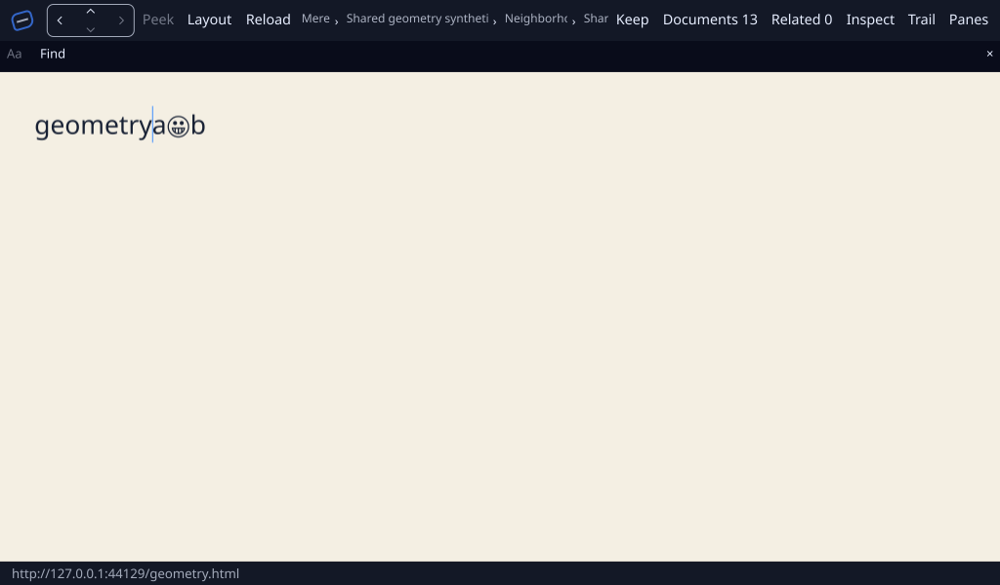
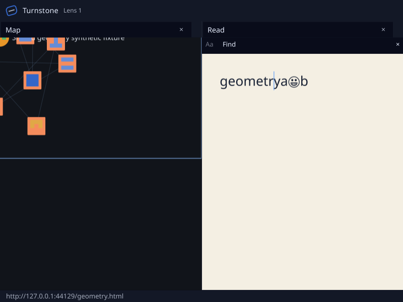

# Shared Genet geometry on Linux/Vulkan, 2026-10-27

**Bounded programmatic receiving passes.** A native Wayland Turnstone run on
AMD Radeon Graphics / RADV Renoir delivered shared Genet caret geometry to the
window system for both its primary window and a document lens. This closes the
SSH-blocked Linux rerun recorded in the October 24 geometry assessment.

- **Hardware and window-system evidence agree.** The standalone Genet geometry
  test rejects a CPU adapter and asserts Vulkan. Captured source rasters from
  both native windows identify RADV Renoir, Mesa 26.2.5 and Vulkan. The headed
  checker compares the app's physical caret rectangles, divided by each native
  window's recorded display scale, with actual `zwp_text_input_v3`
  `set_cursor_rectangle` messages. Both windows match within one logical pixel.
- **Coordinates survive a real zoom and a window move.** The primary caret
  height changes from 34 to 37.4 pixels after 110% page zoom; the lens receives
  the 37.4-pixel geometry. The native display scale is 1. The separate provider
  and placement fixtures exercise scale 2; this run does not establish native
  high-DPI behavior. The retained native Livery document is served over loopback
  from the synthetic [fixture](headed-qualified/fixture.html).
- **Five focused test functions pass.** The standalone geometry test covers
  semantics-disabled publication, logical coordinates, UTF-16 commit offsets,
  hiding and retirement. Turnstone's current-appearance primary/lens geometry,
  IME admission, asynchronous Vulkan frame-custody and scenario-grammar tests
  pass. The window/receiver checks reject geometry from another appearance,
  an edit pending layout, hidden content and replaced receivers.
- **The native scenario needs an explicit content target.** The scenario runner
  now accepts `click-content-window <window> <x> <y>`. It requires a focused
  native window, refuses host editors and non-content hits, and uses the existing
  mouse, content-focus admission and release routing helpers. Only
  `src/scenario.rs` and `src/shell/drive.rs` change for this fixture support;
  the caret mapping, publication code and dependency lockfile are unchanged.
- **Rejected observations remain evidence.** In [the first run](headed-first/run.json),
  the scenario completed but the checker rejected the missing lens caret: focus
  stayed on the lens's Map pane. [The second run](headed-focused/run.json) reached
  Wayland in both windows but its scenario rejected an unscoped `insert` step.
  [The final run](headed-qualified/run.json) explicitly clicks lens content,
  waits for focus/layout and uses a window-targeted caret key. Both the scenario
  and geometry checker pass on the same executable as the second run. An exit
  status of zero or a successful screenshot alone is insufficient.
- **Access recovered without a DNS change.** Djinn's resident native prompt
  unlocked the Mac's mesh identity and authenticated SSH to the ThinkPad.
  GitHub resolution initially failed; normal application and system-resolver
  lookups, followed by Git access and locked dependency fetches, succeeded on
  retry. DNS configuration was unchanged. Exact source bundles and missing
  cached Git objects were transferred over the authenticated SSH connection;
  the temporary transfer service was stopped afterwards.
- **This is a programmatic geometry qualification.** It does not qualify physical
  keyboard input, OS candidate-popup placement, physical CJK methods, human AT,
  Servo IME or password editing-offset to masked-glyph accuracy. The original
  [physical Typing Booster receipt](../cue_ime_linux_20261024/README.md) remains
  unchanged. The earlier [macOS/Metal geometry receipt](../cue_text_input_20261024/README.md)
  retains its own source and platform bounds.

The source and executable identities are in [receipt.json](receipt.json),
[cohorts.json](cohorts.json), [source verification](focus-source-verification.json)
and the executable manifests. Cargo's resolved 1,062 Linux package sources match
its locked records. The SDK and consumer retain their own pinned cohorts; the
Genet geometry/API source files are identical between their two Genet pins.
Original drivers, complete raw logs, source checkouts and frozen executables are
retained in `Code/output/cue-geometry-linux` on the execution machines. Published
text redacts machine-specific home prefixes; input hashes in the run records
identify the original executed drivers. [SHA256SUMS](SHA256SUMS) covers every
other file in this directory.

Primary at 110% page zoom:

Document lens after explicit content focus:

