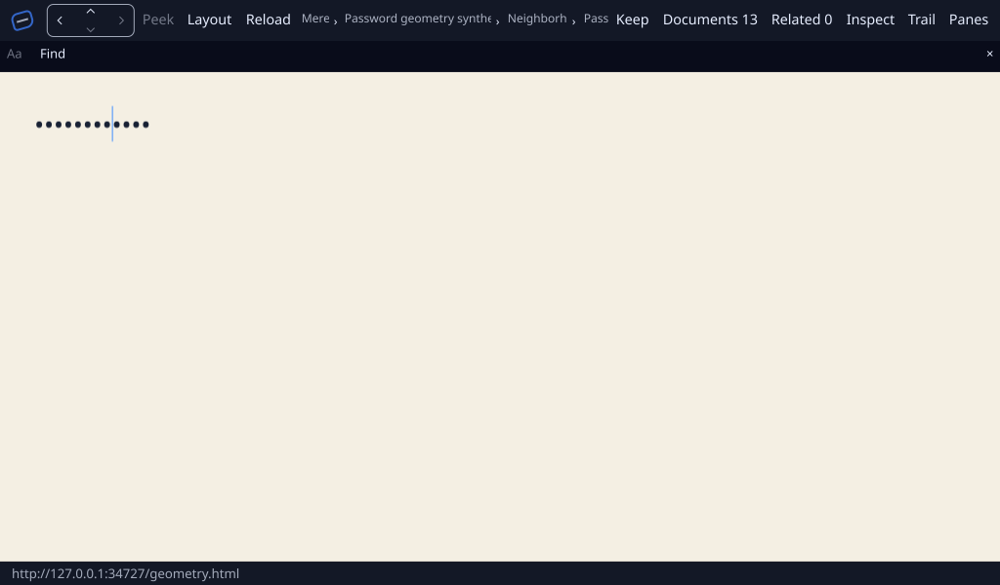
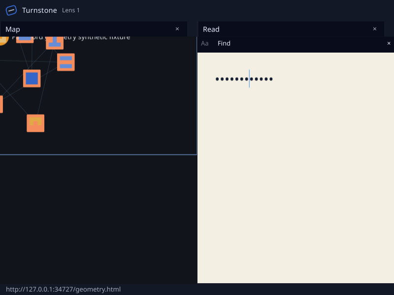

# Genet password geometry on Linux/Vulkan, 2026-10-27

**The password projection defect is fixed, and bounded native receiving passes.**
Genet now maps editing-value byte offsets through the grapheme-counted bullet
string it actually shapes. The mapping lives in retained native text queries;
static and scripted document sessions and the shared producer inherit it.

- **Editing and display have distinct indices.** A caret inside an extended
  grapheme uses that bullet's leading edge. A nonempty partial-grapheme selection
  expands outward to the touched bullet. Hit testing maps a bullet edge back to
  a source-byte boundary. Caret, selection, find and text-directive queries keep
  source-byte results; selection text and paint keep the mask. Retained frames
  store numeric boundaries, with no extra plaintext copy. Same-mask edits refresh
  those boundaries, and changing the control type removes the password projection.
- **The regression was reproduced before the repair.** The actual
  [red run](baseline-red.log) executed both new layout tests against the original
  implementation: zero passed and two failed. Earlier cache/ignored-lock setup
  failures are retained in the raw output lane and are not counted as regression
  evidence. The [fixed full layout suite](retained-layout-suite.log) passes
  359 tests with two existing ignored tests. Its password subset passes three.
  ASCII, multibyte scalars, combining marks, family emoji and flags are compared
  against actual bullet text, in LTR and RTL. Checks cover every grapheme edge,
  reverse hits, selection rectangles, same-mask changes and type changes.
- **Both document paths and the GPU producer receive the repair.** Five focused
  static/scripted shared-geometry tests pass. They preserve UTF-16 editing
  selections and exclude password values from metadata. A combining-mark commit
  changes the source offset without adding a bullet or moving its correct caret
  edge. Both native SDK geometry tests pass on RADV Renoir / Vulkan, including
  semantics-disabled password publication, hiding stale geometry, a prepared
  frame and nonblank GPU readback. Scale 2 is a programmatic producer fixture.
- **Native host geometry agrees with Wayland.** Turnstone's primary/lens
  geometry, IME admission and asynchronous frame-custody tests pass. A clean
  consumer build opens the synthetic password fixture, inserts text, applies
  110% page zoom, tears out a document lens and targets its content explicitly.
  The [headed run](headed-qualified/run.json) passes its scenario and compares
  shared physical caret rectangles, divided by each window's display scale,
  against actual `zwp_text_input_v3.set_cursor_rectangle` messages within one
  logical pixel. Both windows match. Caret height changes from 33 to 36.3 pixels;
  the lens receives 36.3. Captured rasters identify hardware Vulkan in both
  windows, at native display scale 1.
- **Dependency changes stay within the Genet cohort.** The SDK adapter pins the
  fix and adds the native regression. Turnstone's lock changes only 33 Genet
  source revisions; Mere's root and web locks change only 36 and 24 respectively.
  [Source hashes](source-verification.json) bind the tested owner/SDK patch files
  to their published commits. Turnstone's 1,062 resolved Linux package records
  match its lock. Mere root and wasm web locked metadata both exit zero and use
  the fixed Genet source; web's 720 records match its lock. Root metadata emits
  `netrender_device` at `66b2f72e` while the original lock records `d9d6e778`;
  that unrelated pre-existing split is retained in
  [the metadata check](mere-resolved-lock-verification.json), with no dependency
  selection change and no new Mere compile claim. Concurrent upstream browser
  frame-backpressure work is preserved by a fast-forward before publication.
- **The physical qualification retains its own bounds.** This is synthetic input
  and programmatic geometry receiving. It does not repeat physical Typing Booster,
  OS candidate-popup placement, CJK or human AT exercises, native high-DPI, X11
  or Servo IME. The [October 24 physical receipt](../cue_ime_linux_20261024/README.md)
  and [earlier ordinary-field geometry receipt](../cue_geometry_linux_20261027/README.md)
  remain byte-for-byte unchanged. The defect closure removes the earlier
  password-offset caveat; their other acceptance limits still apply.

[receipt.json](receipt.json), [cohorts.json](cohorts.json), executable and source
manifests bind the run. Raw originals, full metadata, source checkouts and the
frozen executable remain in `Code/output/genet-password-caret` on the execution
machines. Published text redacts home prefixes;
[original hashes](original-evidence-sha256.json) identify pre-redaction bytes.
[SHA256SUMS](SHA256SUMS) covers every other published file.

Password field after page zoom:

Document lens after window-targeted caret movement:

