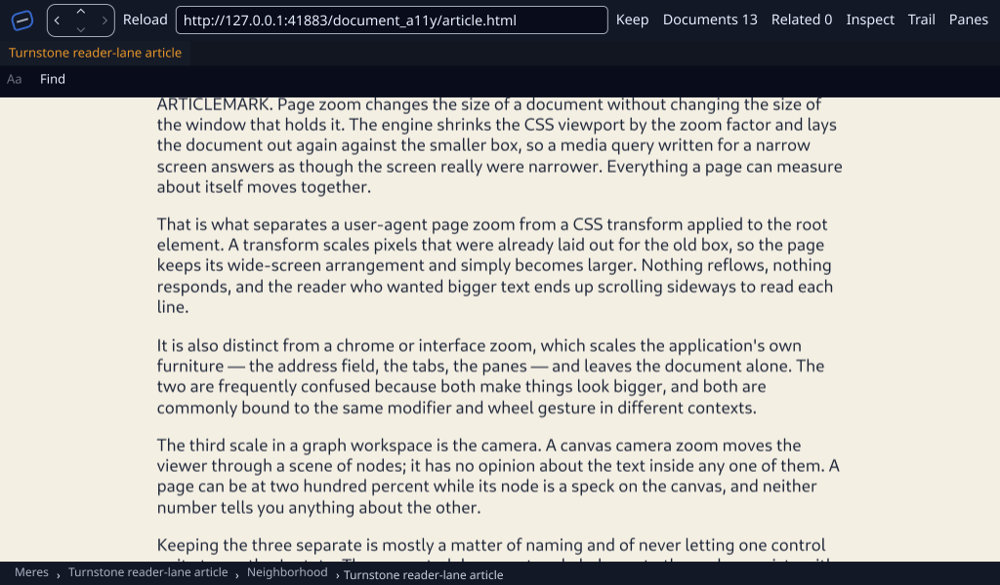

# Genet canvas-colour repair on hardware Vulkan and native Wayland — 2026-10-23

**Qualified:** the observed Genet scroll-background defect is repaired in
Turnstone's retained host-device consumer. At 110% zoom, a positive 120-pixel
scroll moves the document while the CSS canvas colour stays in the viewport.
The new executable also passes the retained Genet/Reader primary/lens/return
case, live taxonomy and controls, and the focused Linux regression gates.

The [qualification record](qualification.json) separates the original negative
raster from the repaired receiving result. The
[earlier Linux receipt](../cue_ui_linux_20261023/README.md) remains byte-identical,
including its failed appearance finding. This receipt supersedes that finding
for the tested retained canvas-colour path; other qualification bounds remain.

## Repair and source cohort

- Genet code: `621aa33cce3d3fc3c708313efef4c7b825d8a953`.
- Mere supplier: `b0e7647ff014a3c2c475f8c608d6ac99b75f65d2`.
- Turnstone compiled/receiving source:
  `0fc28484322a4863d49dd79c2321da99c2c1d268`.
- Netrender: `8a3d289a233fe55d662de6971f2119c3d2a758c0`.
- Runtime executable SHA-256:
  `557e1730d0f06e76b309997a12400148083ebefe429f28625b63406c03b540cf`.
- Rust 1.99.1, default Turnstone features; kernel
  `7.2.11-200.fc44.x86_64`, Mesa 26.2.5.

[Source identities](source.json) record all Turnstone Rust inputs, relevant
supplier/producer inputs, Cargo files, receiving scripts, scenarios and the
resolved Git package cohort. Final gate records also bind the test binaries,
clean source status, unchanged lock hashes and exact commands.

Genet's `LiveryPaintList::scrolled` leaves the propagated canvas-colour command
outside the document transform. Cached and freshly repainted frames, the
scripted owner and Rootstock use that operation. Ordinary element backgrounds
and child/text/host slots remain in document coordinates. Full-surface placement
and page scale still include the canvas. Producer-local bookkeeping leaves the
serialized paint-list shape unchanged; transparent canvases stay transparent.
Background-image emission is unchanged.

The [Genet provider receipt](https://github.com/merely-made/genet/tree/b7db1677762adcf149cfd5dec4cd3019155770a1/docs/receipts/canvas_scroll_20261023)
preserves failing pixel tests, the repair, final source/lock hashes and the full
Livery result: **725 passed, 8 explicitly ignored**. Its five CPU raster tests
cover cached scroll, retained repaint, root/body colour propagation, fractional
zoom, transparent canvases, surface placement and a spliced child. The scripted
lane compiles. The provider receipt also retains two existing test/example
compatibility repairs needed by the full run.

The refreshed consumers required explicit HTML atom string interpretation in
Cambium, Nematic and Turnstone favicon discovery. The root ESP patch follows
Mere's current cohort to preserve one type family. Initial offline refusals,
compiler refusals and the corrected build are retained under `validation/`.
The Servo repository's deliberately invalid tidy fixture also appears in Cargo
source-discovery output; final command outcomes and lock invariance are recorded
separately. Warnings remain in the logs.

## Scroll appearance

The same [pixel checker](../../../scripts/check-cue-scroll-background.py) was
executed against both actual producer-raster pairs. Replay it with the
`before-scroll` or `repaired-controls` directory and a fresh output JSON path.
It checks canvas colour, actual document movement and stable producer scope.

| Observation | Original raster | Repaired raster |
| --- | --- | --- |
| Pixel `(8,469)` after scrolling | `(0,0,0,0)` | `(244,239,227,255)` |
| Incorrect rows on the sampled 477-row canvas margin | 120 | 0 |
| Content follows the 120-pixel upward translation | Yes | Yes |
| Same live producer scope before/after scroll | Yes | Yes |
| Appearance gate | Rejected, exit 1 | Passed, exit 0 |

The [original negative result](validation/original-scroll-pixels.json) names
rasters copied without modification from the earlier receipt. The
[repaired positive result](validation/repaired-scroll-pixels.json) names the new
source rasters. The centre's shifted-pixel mismatch fraction is about 0.000489;
the unshifted image differs by about 0.27447, so retaining the canvas colour did
not suppress scrolling. Source raster and composed-capture inspection confirms
that the former lower transparent band is gone.

## Executed receiving and validation

Both native cases use the same executable and fresh synthetic profiles in an
unlocked GNOME Wayland session. `DISPLAY` is absent. `WGPU_BACKEND=vulkan` and the
Radeon x86-64 ICD are selected; actual source observations identify **AMD Radeon
Graphics (RADV RENOIR), Vulkan, IntegratedGpu, vendor 4098, device 5686**. The
receiving driver requires nonempty sampled shared-content observations and
rejects blank lens content and non-hardware adapters.

| Gate | Result |
| --- | --- |
| Final locked/offline Linux product build | Passed |
| Default locked/offline Linux all-targets check | Passed |
| Explicit pending-frame Vulkan regression | 1 passed, 0 ignored |
| Turnstone history/control regressions | 7 passed |
| Turnstone live Inspector cohort | 27 passed, 2 endpoint-dependent ignores |
| Turnstone browse regressions after atom compatibility repair | 12 passed |
| Pelt shared-contract suite, including explicit GPU cases | 9 passed, 0 ignored |
| Retained Genet/Reader primary, lens and return/dock | 241 primary presentations, 3 nonblank primary captures and a sampled composed lens capture |
| Live taxonomy, zoom, actual scroll and close/reopen | 293 primary presentations, 5 nonblank primary captures |
| Old-raster negative and repaired-raster positive pixel gates | Correctly rejected / passed |

The controls case asserts all 28 live feature rows, `linux`, `HostDevice`,
`Observed`, `DocumentSnapshot`, requested/applied zoom of 110%, and live content
after close/reopen. The recorded scope changes from `1:1` to `2:1` on reopen.
The scroll itself retains scope `1:1`. Native keyboard exposure remains
unavailable and IME support remains partial in that report.

Mac consumer validation is preserved separately: Rootstock **169 passed,
3 ignored**, Pelt **6 unit tests passed**, and Nematic **237 library tests plus
3 example tests passed**. The Rootstock/Pelt run used the frozen post-resolution
lock offline; a separate locked/offline check passed. Nematic's run was locked
and offline. These results are distinct from the Linux GPU tests above.

Pelt's canonical IME test still emits the ICU4X diagnostic about a missing
Chinese/Japanese complex-script segmentation model while passing its canonical
composition assertions. This gives no CJK segmentation-quality or physical IME
acceptance claim. The full Turnstone library was not rerun on Linux.

## Retained limits and preservation

This qualifies the repaired retained **host-device** direction on hardware
Vulkan/native Wayland. The Linux shared native-frame importer and concrete
Servo binding, X11/Xwayland, physical IME/candidate-window behavior, human
assistive-technology acceptance, physical device loss, native alpha/colour and
OS-compositor pixel correlation retain their separate gates. Captures come from
the production composition path alongside successful native presents; they are
not an OS-compositor screenshot qualification.

All 176 files in the earlier Linux receipt retain their original hashes. The
three local primary checkouts and 13 preexisting ThinkPad worktrees retain their
starting heads and tracked/untracked status. No build or application process
remains from receiving. Private profiles, executables, raw application output
and full scene dumps remain outside this public receipt. Synthetic captures,
source observations, exact commands and selected validation logs are sealed by
`SHA256SUMS`.
