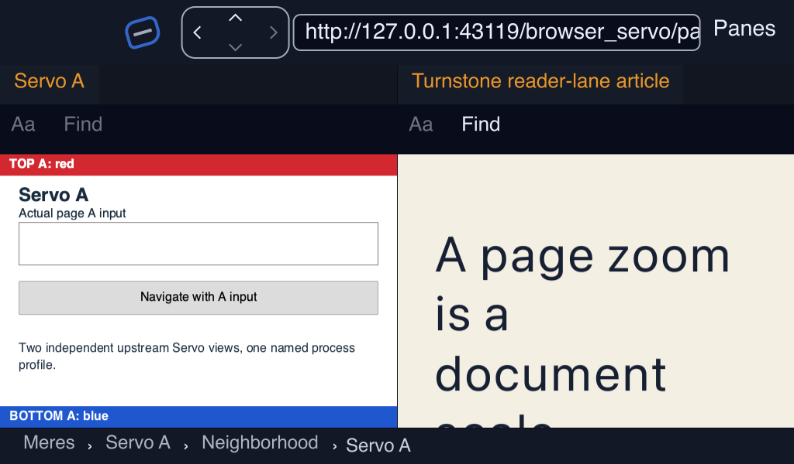
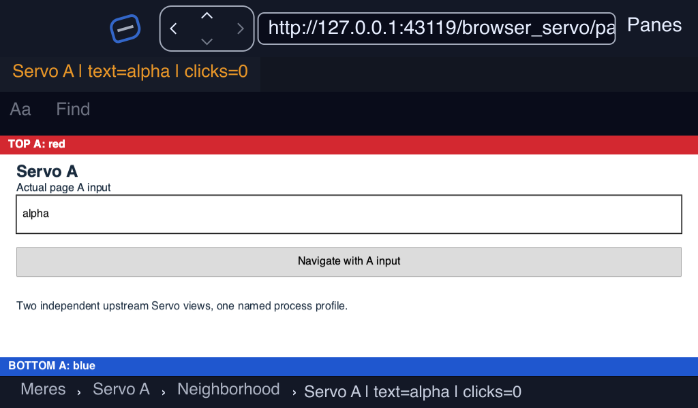

# Turnstone product UI receiving through Cue — 2026-10-23

**Qualified scope:** the real Turnstone content pool, main-window compositor,
lens compositor, Inspector and per-card engine selection on macOS/Metal.
Retained Genet/Reader content and the concrete Servo binding reach these paths
through the published Cue contract. This receipt is separate from the earlier
finite `cue_surfaces` example.

The implementation is `5e9e3bfea88e9e9b9133d01ec9486ed7fd056322`, consuming
Mere `86796a2447d68b3e6538d0ceff9f387a5d56e29c`. The final runtime executable's
SHA-256 is `c962c7f715dc5e020b258d89034c8bdc1deaf6cf168adcfddcd3f71dcda3726f`.
All three final UI cases used that executable. [Source identities](source.json)
record each changed Rust/Cargo file's hash; [gates](gates.json) record the
qualification bounds and outcomes.

## What changed and why it matters

- **The placement pool retains the session.** A borrowed `PeltSceneSource`
  renders the exact admitted controller. Fetching, routing, graph history,
  reading resources and independent Reader appearances retain their owners.
  Source replacement retires the previous Cue scope.
- **Both windows consume shared presentation.** Turnstone's Cue cache lends
  the primary host's device/queue to private retained renderers, or imports
  Servo's owned native frame on that same host. The common presenter checks
  scopes, extents, device epochs and content revisions.
- **Pending frames retain a later mutation's redraw.** Pool paint revisions
  track input, resource access, runnable work and exact due timers. Completing
  an older frame cannot swallow the final input update. Geometry that is not
  currently admitted skips presentation during a station transition.
- **Control reads preserve semantic admission.** Bounded Cue event drains do
  not borrow the entire pool mutably or invalidate retained accessibility
  publications on each wake. Browser navigation, title, cursor, extension
  messages and correlated zoom results flow through that single stream.
- **History follows actual browser commits.** A pending Back/Forward records
  the expected neighbour. A matching observed address moves the existing
  graph-history cursor; an ordinary link to an old address remains a new
  visit. Duplicate old-address callbacks retain the pending intent. Refusals
  match the request's complete scope and id before withdrawing that intent.
- **The Inspector reads the effective report.** The visible Content table
  includes engine, platform, presentation, evidence, semantic protocol and all
  28 features with their partial/unsupported reasons. Existing per-card viewer
  selection and saved pins remain app-owned.

## Executed evidence

| Gate | Result |
| --- | --- |
| Current Turnstone library, complete disjoint partition | **1,183 passed, 0 failed, 17 ignored** |
| Non-place cohort, four workers | 1,107 passed, 17 ignored, 76 filtered |
| Place cohort, serial networking fixtures | 76 passed, 0 failed, 1,124 filtered |
| Current Inker/Pelt focused suites | 259 passed; explicit GPU and documentation ignores remain named in the log |
| Pelt Cue suite with explicit real-GPU cases | **9 passed, 0 ignored** |
| Turnstone pending-frame GPU regression | **Passed explicitly**: input between red submission and completion reaches a settled blue frame on the same retained receiver |
| Default-feature `cargo check --all-targets --locked --offline` | Passed |
| Servo-feature library Clippy | Passed with warnings |
| Retained UI | **Passed**: primary, Reader, floating/tiled lens, return/dock; 226 primary presentations and four composed captures including the lens |
| Servo UI | **Passed**: committed text and deletion, navigation, Reload, Back/Forward, effective 110% zoom, lens, return/dock and close/reopen; 484 primary presentations and fourteen composed captures including the lens |
| Mixed UI | **Passed**: Servo and Genet rendered side by side on one host, with per-card selection; 720 primary presentations and four composed captures |

[The partition receipt](validation/cue-ui-final-suite-partition.json) verifies
that the two current-source cohorts cover every name in the compiled
1,200-test library exactly once. The new GPU regression is one of the normal
suite's explicit ignores and was also executed separately. The networking
fixtures run serially to avoid the prior concurrent-fixture timeouts. Transport
shutdown diagnostics in their logs are not test failures; each cohort exited
successfully. Cargo also emits a diagnostic for Servo's intentional invalid
`python/tidy/tests/lints-configuration/no-workspace/Cargo.toml` fixture during
discovery; command outcomes are recorded separately.

Each final case contains its exact `scenario.scn`, `scenario.done`, binary
identity, composed PNGs and per-checkpoint `.cue-frames.json` observations:

- [Retained case](retained-final/scenario.done): a sampled host-device frame
  is required in the lens as well as the main window.
- [Servo case](servo-final/scenario.done): the producer scope is unchanged
  across main/lens/return stations and changes after closing and reopening.
- [Mixed case](mixed-final/scenario.done): both `host-device` and
  `native-frame` entries have sampled layers in the same checkpoint. Browser
  polling keeps the global idle diagnosis runnable; this is not an idle gate.





## Preserved negative and intermediate evidence

- `retained-attempt1` and `servo-attempt1`: the first station fixtures used
  Dock/Return as though a tiled lens pane were already floating. The fixtures
  now explicitly float, transfer, dock, float, return and dock.
- `retained-attempt2`: a transient non-admitted rectangle was treated as a
  fatal backend error. The presenter now skips that geometry, preserving the
  retained receiver.
- `retained-attempt3`: the old driver accepted a nonblank lens window even
  when it contained no sampled document frame. Its outcome is retained along
  with an explicit qualification-limit record. The final driver requires a
  nonempty sampled content receipt for every lens checkpoint.
- `servo-attempt2` and `servo-wait-failure`: retain the failed text/history
  observations. The host's traversal bookkeeping was repaired and tested.
  The legacy blocking row wait only sees open panes; composed checkpoints now
  return to the native event loop before page-text assertions.
- `focus-probe1`: a successful bounded typing/focus probe, separate from full
  station and history acceptance.
- `servo-timeout`: the four-minute run reached return/dock but had no complete
  outcome before its own process was terminated. It remains incomplete. The
  final driver has a finite eight-minute default and the complete Servo case
  passed within it.

## Bounds that remain

The receipt qualifies scripted host input, composed native-window frames and
successful present calls on Metal. Physical keyboard/IME and candidate-window
acceptance, human assistive-technology acceptance, OS-compositor pixel
correlation, physical device loss, and transparent native colour/alpha
acceptance remain separate gates. Servo's shared IME/semantic exposure and
host-import evidence feedback are still absent; its live shared report remains
`Constructed` even though these external receiving receipts observe imported
frames. Native browser polling remains runnable rather than proving global
idle.

Retained content uses the shared UI path on other builds too, but this receipt
does not qualify Linux/Vulkan or a fresh Windows run. Concrete Weld/Scry native
bindings still use their existing product paths. Those adapters and their
platform qualification remain distinct from the now-exercised shared UI
consumer.

## Reproduction

Build `turnstone` with `--features servo --locked` using the pinned cohort and
Rust 1.99.1, then serve `scenarios/fixtures` from a loopback HTTP server. Each
invocation needs a fresh absolute output directory and the logged-in macOS GUI
session:

```sh
python3 -m http.server 43119 --bind 127.0.0.1 --directory scenarios/fixtures
scripts/receive-cue-ui-mac.sh "$BINARY" "$REPO/scenarios/cue_ui_retained.scn" /tmp/cue-retained-fresh http://127.0.0.1:43119
scripts/receive-cue-ui-mac.sh "$BINARY" "$REPO/scenarios/cue_ui_servo.scn" /tmp/cue-servo-fresh http://127.0.0.1:43119
scripts/receive-cue-ui-mac.sh "$BINARY" "$REPO/scenarios/cue_ui_mixed.scn" /tmp/cue-mixed-fresh http://127.0.0.1:43119
```

The driver creates an isolated `.app` and synthetic profile, records the exact
scenario and binary hash, and cleans up only its own process. Application
bundles, executables, profiles and raw diagnostics remain local. The public
receipt contains synthetic captures, bounded outcomes, identities and logs;
`SHA256SUMS` covers every published receipt file except itself.
