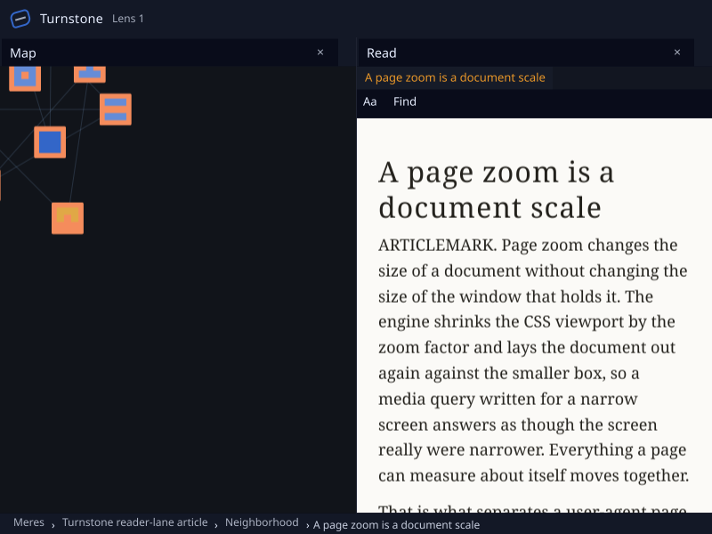
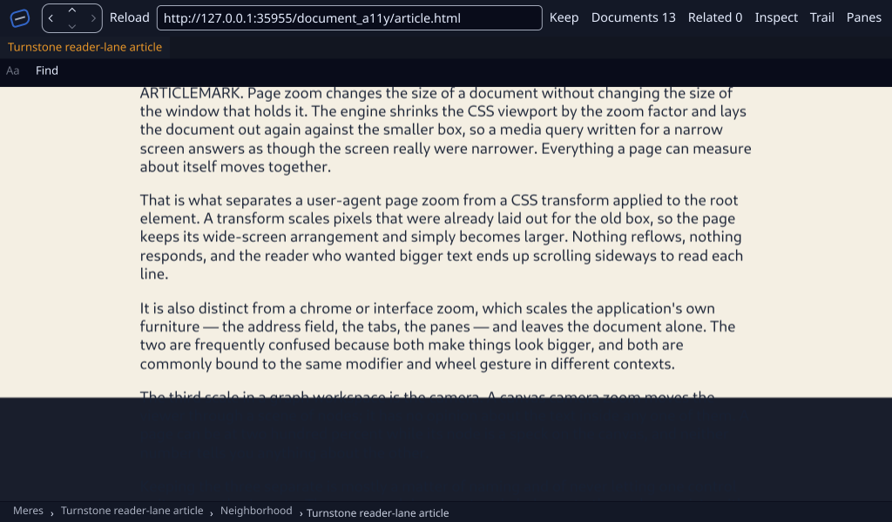

# Retained Cue UI on hardware Vulkan and native Wayland — 2026-10-23

**Qualified:** Turnstone's retained Genet/Reader shared UI consumer on the
ThinkPad's AMD Radeon Graphics (RADV RENOIR), using Vulkan in an unlocked GNOME
Wayland session. The real content pool, primary composition, lens composition,
live Inspector, zoom, scroll and close/reopen paths were exercised.

**Still open:** the Linux native-frame Cue importer and concrete shared Servo
binding, and a visible Genet canvas-background defect after scrolling. This
receipt does not qualify correct opaque viewport coverage after scroll or both
frame directions on Linux. Physical
IME/candidate-window behavior, human assistive-technology acceptance, X11 and
Xwayland, physical device loss and OS-compositor pixel correlation retain their
own gates.

[The qualification status](qualification.json) separates successful receiving
gates from the failed scroll-background appearance check and the unimplemented
Linux native-frame direction.

## Source and receiving configuration

- Final Turnstone receiving cohort: `b4628119208e970eb485d45f83f88c7586e4fee6`,
  containing implementation `5e9e3bfea88e9e9b9133d01ec9486ed7fd056322`.
- Initial receiving cohort: `86ccb619ba506d2a17d3fea0f26d0cf82566abd0`, preserved
  separately. The intervening commit changes only Cargo.toml and Cargo.lock.
- Mere supplier: `86796a2447d68b3e6538d0ceff9f387a5d56e29c`.
- Rust: 1.99.1, `x86_64-unknown-linux-gnu`; default Turnstone features.
- Runtime binary SHA-256:
  `ec18a4abedea09ab01fa1d180421962bba1ae2e1006cceb8387a4122edd7448a`.
- Fedora kernel `7.2.11-200.fc44.x86_64`, Mesa 26.2.5 RADV.
- `WGPU_BACKEND=vulkan`, with `VK_DRIVER_FILES` restricted to the installed
  Radeon x86-64 ICD. `WAYLAND_DISPLAY=wayland-0`; `DISPLAY` was removed.
- The actual pre-staging source-raster observations identify backend `Vulkan`,
  device type `IntegratedGpu`, vendor 4098 and device 5686. Backend selection
  alone is not the adapter evidence.

[Final cohort identities](cohort-source.json) bind the refreshed executable,
manifest, lock and 17 unchanged Rust inputs. The [initial identities](source.json)
bind the earlier executable and the same 19 Rust/Cargo input hashes used by the
Metal implementation. [Supplier identities](supplier-source.json)
bind the pinned Mere lock and 46 Inker/Pelt source/test files. No rendering or
shared-protocol source change was made for this qualification. The new driver,
scenario and documentation are separate from that compiled source snapshot.

The initial [offline build refusal](validation/build-offline.log) records the
missing pinned Mere checkout. The subsequent locked build fetched the exact
resolved cohort and passed; Cargo.lock was unchanged. Build/test warnings remain
in the logs. The full Turnstone library was not rerun on Linux.

## Executed gates

| Gate | Outcome |
| --- | --- |
| Locked Linux product build | Passed |
| Default Linux all-targets check, locked/offline | Passed |
| Explicit Turnstone pending-frame Vulkan regression | **1 passed, 0 ignored** |
| Turnstone history/control regressions | **7 passed** |
| Turnstone Inspector cohort | **27 passed, 2 explicit endpoint-dependent ignores** |
| Pelt shared-contract suite, including explicit GPU cases | **9 passed, 0 ignored** |
| Retained Genet/Reader primary, lens and return/dock | **Passed: 241 primary presentations, 3 nonblank primary captures and a composed lens capture** |
| Live taxonomy, zoom, scroll dispatch and close/reopen | **Passed: 291 primary presentations, 5 nonblank primary captures; scroll appearance defect remains open** |
| Receiving-driver negative controls | **Passed: software Vulkan, wrong backend and blank sampled lens were refused** |

The [final cohort gates](cohort-gates.json) preserve the refreshed build, focused
tests, all-target check and both native cases. The [initial gates](gates.json)
preserve the earlier receiving and the unchanged supplier's nine-test suite.
The pending-frame regression submits red, changes the same retained
receiver to blue before completion, observes the older frame and reaches a
settled blue frame. Unadmitted geometry skips presentation. The Pelt suite covers
ordered requests, canonical IME composition, hidden-input refusal, semantic
retirement, pool custody and two retained producers sharing one device.

Pelt's canonical IME test emits an ICU4X diagnostic about a missing Chinese/Japanese
complex-script segmentation model, while its assertions pass. This receipt does
not claim CJK segmentation quality or physical IME acceptance.

The final product cases use the same executable and fresh synthetic profiles:

- [Retained Wayland outcome](cohort-retained-wayland/scenario.done),
  [scenario](cohort-retained-wayland/scenario.scn), and
  [actual adapter observation](cohort-retained-wayland/01_retained_primary.sources.json).
  The lens has a nonempty scoped shared-content observation with 19 sampled
  layers; a nonblank chrome window alone would not satisfy the driver.
- [Controls Wayland outcome](cohort-controls-wayland/scenario.done) and
  [scenario](cohort-controls-wayland/scenario.scn). Assertions inspect the actual live
  Inspector rows: `linux`, `HostDevice`, `Observed`, `DocumentSnapshot` and all
  28 feature answers. IME remains partial, and native keyboard exposure remains
  unavailable. Requested and applied zoom reach 110%. The close/reopen checkpoints
  replace producer scope `1:1` with `2:1`.

These are scripted host-input and composed-window receiving observations.
Captures come from the production composition path and are accompanied by
successful native present calls; they do not correlate pixels with the OS
compositor or supply human accessibility acceptance. Lens admission may have a
new asynchronous frame pending while already sampling valid content; this is
not a global-idle or latency qualification.



## Scroll appearance finding

The final controls fixture uses a positive 120-unit document delta. The earlier
controls cases used a negative delta while already at the top; they qualify
dispatch and subsequent presentation, not downward movement. The corrected
capture visibly moves the heading out of view and exposes a canvas-background
gap near the bottom.

[The defect record](scroll-background-defect.json) separates the observation
from its source-supported explanation. In the actual producer raster, pixel
`(8, 469)` changes from beige `(244,239,227,255)` before scroll to transparent
`(0,0,0,0)` after scroll. The host's dark background then shows behind document
text. The missing fill already exists before the host stages that texture.
Pinned Genet `7d1d89db` emits a viewport-sized canvas background and translates
the entire cached paint list by document scroll, including that rectangle.
Keeping the canvas fill anchored to the viewport would preserve the expected
background while document content moves. No renderer repair is included here.



## Preserved refusal and guard evidence

[The first controls case](controls-missing-observations/driver.log) passed its
scenario assertions and produced nonblank captures, but omitted `record-idle`
steps and therefore supplied no shared-frame observations. The receiving driver
correctly rejected it. Its `run.json` remains `passed: false`; the final fixture
adds those observations and passes. This is a fixture/receipt correction, not a
rendering fix.

[Guard controls](guard-controls/summary.json) use explicitly synthetic executables
and fabricated metadata to check three refusal paths. They supply no native UI
or hardware evidence. Their logs remain separate from the product cases.

## Platform boundary and preservation

At the tested source, `src/shell/cue_content.rs` uses `NoNative` outside macOS and
returns `no shared native importer on this host`. Turnstone's concrete Servo
registration is gated to Windows/macOS; the published `wgpu-cue` 0.1.1 exports
only `GraftMetalImporter`. Graft's lower Vulkan/DMA-BUF primitives do not fill
those shared-adapter and product-binding gaps. No native browser fallback was
used to turn the retained result into a native-frame claim.

Fresh Windows receiving, native Servo IME/semantic exposure, host-import feedback
into native capability evidence, transparent native colour/alpha, cross-GPU
import and physical device-loss acceptance remain separate work.

[Before](preservation-before.json) and [after](preservation-after.json) records
confirm that the pre-existing ThinkPad primary checkouts and unrelated worktrees
kept their HEADs and status. New isolated source checkouts preserve the tested
revisions. Existing caches were reused without cleanup. Each receiving driver
owns a finite application process group; each fixture server is scoped to its
run. Executables, profiles, raw application output and full diagnostic scenes
remain local. This packet selects synthetic captures, bounded outcomes, source
identities and validation logs.

## Reproduction

Build the pinned Turnstone source with Rust 1.99.1 and `cargo build --bin
turnstone --locked`. In an unlocked native Wayland desktop session, select the
hardware Radeon ICD and serve `scenarios/fixtures` from a loopback HTTP server.
Use the repository's `scripts/receive-cue-ui-linux.py` with a fresh absolute run
directory for each scenario:

```sh
python3 scripts/receive-cue-ui-linux.py "$BINARY" "$REPO/scenarios/cue_ui_retained.scn" /tmp/cue-retained-fresh http://127.0.0.1:43119
python3 scripts/receive-cue-ui-linux.py "$BINARY" "$REPO/scenarios/cue_ui_linux_controls.scn" /tmp/cue-controls-fresh http://127.0.0.1:43119
```

[The exact native runner](run-native.py) records desktop/ICD settings and owns
the ephemeral loopback server. [The check runner](run-checks.py) records each
focused command and its process-only descriptor limit. `transfer-sha256.json`
records the 100 files verified after copying from the ThinkPad;
`cohort-transfer-sha256.json` separately binds the later cohort transfer.
`SHA256SUMS` covers the final published packet, excluding itself.
